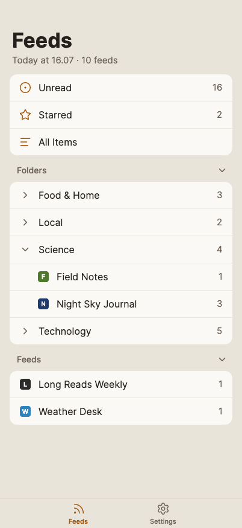
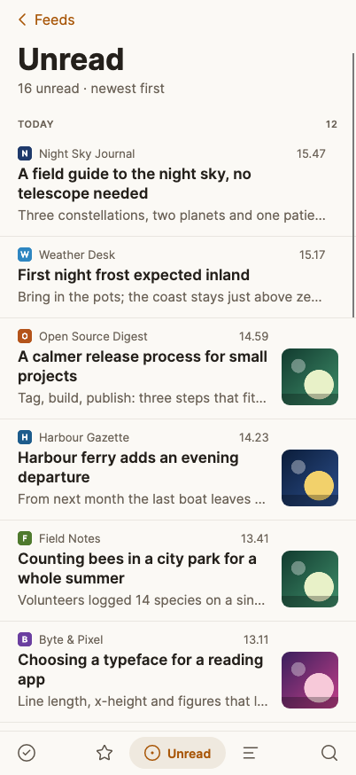
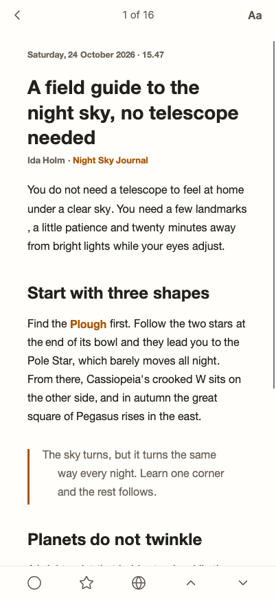
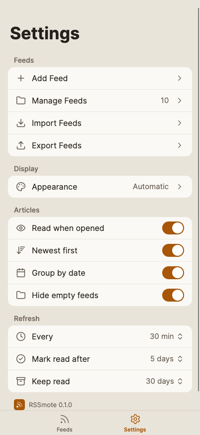

# RSSmote

[English](README.md) · **Dansk**

En RSS-læser til macOS, Windows og Linux og til iPhone og Android. Tre kolonner på skrivebordet, tastaturet i centrum
og alt gemt lokalt.

**Denne app er skrevet af en maskinintelligens.** Al kode, alle kommentarer, designet, de ti farvetemaer,
app-ikonet, testene, dokumentationen og denne README er lavet af Claude Opus 5.5 (Anthropic, med *reasoning effort*
sat til high) efter beskrivelse fra et menneske. Intet menneske har gennemgået koden linje for linje. Læs afsnittet
[Ansvarsfraskrivelse](#ansvarsfraskrivelse), før du stoler på den med noget, du holder af.


Til venstre er dine feeds, samlet i mapper. I midten er artiklerne, grupperet efter dag. Til højre er den artikel,
du læser. Der er ingen konto, ingen synkronisering og ingen sky: dine feeds og artikler ligger i én SQLite-fil på din
egen maskine.

Bygget i .NET 10 og [Avalonia](https://avaloniaui.net) 12. Kun gratis komponenter med MIT- eller lignende licenser;
se [Docs/dependencies.md](Docs/dependencies.md).

## Hvad den kan

- **Tilføj et feed** ud fra en feed-adresse eller blot adressen på et website. RSSmote finder selv sitets feeds og
  viser dem, før noget gemmes.
- **RSS 2.0, Atom, RDF og JSON Feed.** Feeds med ugyldig XML (fx `&nbsp;` midt i en titel) læses alligevel.
- **Mapper**, der kan foldes ind og ud, med antal ulæste på hver mappe og hvert feed.
- **Filtre**: Starred, Unread og All, plus et filterfelt over listen, der søger i titler, resuméer og feednavne.
- **Artikler i OS'ets egen web-motor** (WebKit på macOS, WebView2 på Windows, WebKitGTK på Linux) med appens egen
  typografi. Scripts, formularer og indlejrede styles fjernes, før siden vises. Hvor der ingen web-motor er, viser en
  indbygget HTML-renderer den samme side.
- **Import og eksport af OPML**, så du kan flytte dine feeds ind og ud.
- **Opdatering** hver halve time i baggrunden og med `r`, når du vil. Læste, ikke-stjernemarkerede artikler ryddes
  efter 30 dage.
- **Ti farvetemaer**, fem lyse og fem mørke. Se [Temaer](#temaer).


## Tastaturet

Hele appen kan styres uden mus. Tasterne virker ikke, mens du skriver i et felt.

| Tast | Gør |
| --- | --- |
| `j` / `k` | Næste / forrige artikel |
| `space` | Rul ned i artiklen; ved bunden går den videre til næste (`shift+space` ruller op) |
| `m` | Markér som læst / ulæst |
| `s` | Stjernemarkér |
| `b` | Åbn artiklen i browseren |
| `n` / `p` | Næste / forrige feed |
| `r` | Opdatér alle feeds |
| `a` | Markér alt i listen som læst |
| `.` eller `esc` | Luk artiklen |
| `⌘1` `⌘2` `⌘3` | Starred / Unread / All (`Ctrl` på Windows og Linux) |
| `⌘F` | Gå til filterfeltet; `esc` rydder det |
| `⌘,` | Indstillinger: tilføj, ret og fjern feeds, import, eksport, udseende; `esc` går tilbage |
| `⌘N` | Tilføj feed (i Indstillinger) |
| `⌘+` `⌘−` `⌘0` | Større / mindre / normal tekst i artiklen |

Uden en artikel valgt viser højre side de vigtigste genveje:


## Skærmbilleder

| | |
| --- | --- |
|  |  |
| Filterfeltet søger i listen, mens du skriver | Omdøb et feed og flyt det mellem mapper |
|  |  |
| Tilføj et feed ud fra en adresse, i Indstillinger | Phosphor: grønt på et slukket rør |

Alle skærmbilleder er taget af appen selv, uden skærm, over et opdigtet demo-bibliotek: feeds, artikler, favicons og
billeder er lavet til formålet (se `ReadmeCaptureTests.cs` i `tests/RSSmote.Desktop.Tests` og
`tests/RSSmote.Mobile.Tests`).

## På mobilen

RSSmote kører også på iPhone og Android, bygget af den samme kode som skrivebordsappen: samme bibliotek, samme
indstillinger og samme ti temaer. Billederne herunder viser iPhone.

| | | | |
| --- | --- | --- | --- |
|  |  |  |  |
| Feeds: strømme, mapper og feeds med antal ulæste | Listen: titler over tre linjer, miniaturer, filteret i bundbjælken | Artiklen: bjælkerne træder til side, mens du ruller ned | Indstillinger: feeds, udseende, læsning og opdatering |

- **Én stak:** Feeds → liste → artikel. Swipe fra kanten eller tryk tilbage for at gå tilbage. Indstillinger er den
  anden fane.
- **Læsning:** forrige og næste er knapper i bundbjælken, ikke swipes. **Aa** sætter tekststørrelse, skrift og lyst
  eller mørkt.
- **Feeds** tilføjes, rettes, fjernes, importeres og eksporteres under Indstillinger, som på skrivebordet. Fjern
  spørger i et ark nedefra.
- **Opdatering:** træk ned på Feeds, eller kom tilbage til appen, når opdateringsintervallet er gået.
- **Ingen synkronisering.** Telefonen har sit eget bibliotek. Flyt dine feeds mellem enheder med OPML-eksport og
  -import.

Artiklerne vises i telefonens egen web-motor (WebKit på iOS, systemets WebView på Android) med billeder og video.
Skærmbillederne er tegnet uden skærm i iPhone 17 Pro-størrelse (402 × 874 pt) med den indbyggede HTML-renderer, så de
har ingen statuslinje.

## Temaer

Du vælger ét lyst og ét mørkt tema under **View ▸ Theme**. Vælger du et tema, skifter appen til det med det samme.
Under **Appearance** kan du sætte den til at følge systemet; så skifter den selv mellem dit lyse og dit mørke tema,
når macOS, Windows eller Linux går fra lyst til mørkt.

| Lyse | Mørke |
| --- | --- |
|  **Sand** — varm sand og rav. Standard. |  **Ember** — Sand vendt om. Standard. |
|  **Newsprint** — sepiapapir og blæk-blå links, til lange læsninger. |  **Black** — helt sort, til OLED-skærme. |
|  **Fern** — grønlige toner under en skovgrøn accent. |  **Fjord** — arktisk blågrå med isblå accent. |
|  **Harbor** — blå accent og brun advarselsfarve, der også kan skelnes ved farveblindhed. |  **Phosphor** — grønt fosfor; kun advarsler er røde. |
|  **Contrast** — sort på hvidt med tydelige kanter. |  **Contrast Dark** — hvidt på sort med tydelige kanter. |

Hvert tema er kun en palet: størrelser, skrift og afstande er de samme overalt. Alle ti skal klare de samme
kontrastkrav (WCAG 2) for tekst, links og knapper, og en test måler dem direkte i temafilerne. Skriften er
[Inter](https://rsms.me/inter/) på alle tre styresystemer, og ikonerne er [Lucide](https://lucide.dev).

## Byg og kør

Kræver [.NET 10 SDK](https://dotnet.microsoft.com/download).

```bash
dotnet build RSSmote.slnx
```

```bash
dotnet run --project src/RSSmote.Desktop
```

Kør testene:

```bash
dotnet test RSSmote.slnx
```

Testene starter den rigtige app uden skærm (Avalonias headless-platform) og tegner den med Skia, så de også fanger
fejl i layout, temaer og kontrast.

### Pakker

`build/` laver en pakke pr. styresystem og arkitektur i `artifacts/packages/`, hver med sin egen .NET-runtime:

```bash
build/package-macos.sh
```

```bash
build/package-windows.sh
```

```bash
build/package-linux.sh
```

macOS-scriptet kræver en Mac; de to andre kører på macOS eller Linux. Ingen af pakkerne er signeret af en kendt
udvikler, så første start spørger:

- **macOS** (14 eller nyere): pak ud, flyt `RSSmote.app` til Programmer, højreklik den og vælg Åbn. Eller fjern
  download-mærket med `xattr -dr com.apple.quarantine /Applications/RSSmote.app`.
- **Windows:** pak ud og kør `RSSmote\RSSmote.exe`; SmartScreen spørger én gang (Flere oplysninger ▸ Kør alligevel).
  Artiklerne kræver WebView2-runtimen, som Windows 11 har.
- **Linux:** pak ud i `/opt` (`sudo tar -xzf RSSmote-…-linux-x64.tar.gz -C /opt`) og kopiér
  `/opt/RSSmote/rssmote.desktop` til `~/.local/share/applications/`. Pakker du ud et andet sted, så ret de to stier i
  filen.

**iPhone og Android:** mobilapperne ligger i `RSSmote.Mobile.slnx` og kræver workloaden `ios` eller `android`
(`dotnet workload install ios android`). iOS kræver også den Xcode-version, workloaden nævner; Android kræver API
36-platformen og JDK 17 eller nyere. `RSSmote.slnx` bygger uden noget af det.

```bash
dotnet build src/RSSmote.iOS/RSSmote.iOS.csproj -r iossimulator-arm64
```

```bash
dotnet build src/RSSmote.Android/RSSmote.Android.csproj
```

**Linux:** artiklerne vises i WebKitGTK 4.1 med libsoup 3. Mangler de, bruger appen den indbyggede HTML-renderer i
stedet, som ikke kan vise video.

### Hvor dine data ligger

Biblioteket hedder `rssmote.sqlite` og indstillingerne `settings.json`. De ligger side om side:

| System | Mappe |
| --- | --- |
| macOS | `~/Library/Application Support/com.ahrentlov.rssmote/` |
| Windows | `%LOCALAPPDATA%\RSSmote\` |
| Linux | `$XDG_DATA_HOME/rssmote/` (ellers `~/.local/share/rssmote/`) |
| iOS | `<app-container>/Library/Application Support/` |
| Android | Appens private filmappe (`/data/user/0/com.ahrentlov.rssmote/files/`) |

Sæt miljøvariablen `RSSMOTE_DATA_DIR` for at bruge en anden mappe, fx til et testbibliotek.

## Hvad appen henter fra nettet

- **Dine feeds** fra de adresser, du har tilføjet.
- **Favicons** gennem Googles favicon-tjeneste (`google.com/s2/favicons`), med sitets domæne som parameter. Google kan
  altså se, hvilke domæner du følger, men ikke hvad du læser.
- **Billeder i artiklerne**, når du åbner dem, fra de servere, artiklen peger på.

Der er ingen analytics, ingen sporing og ingen konto. Links åbnes i din browser, ikke i appen.

## Dokumentation

Projektet er beskrevet i `Docs/`, med en id på hver regel, så kode og dokumenter kan pege på hinanden:

| Fil | Indhold |
| --- | --- |
| [Docs/architecture.md](Docs/architecture.md) | Hvordan appen er bygget op: projekter, shell, lagring, opdatering, artikelvisning |
| [Docs/design-language.md](Docs/design-language.md) | Designet: tokens, temaer, typografi, komponenter, ikoner |
| [Docs/pitfalls.md](Docs/pitfalls.md) | Fejl, der ikke siger noget, med rettelse og den måling der beviser den |
| [Docs/todo.md](Docs/todo.md) | Hvad der mangler, og hvordan det tjekkes |
| [Docs/dependencies.md](Docs/dependencies.md) | Alle pakker med version og licens |
| [src/RSSmote.App/Controls/Templates/templates.html](src/RSSmote.App/Controls/Templates/templates.html) | Katalog over appens egne kontroller |

## Ansvarsfraskrivelse

**Skrevet af en maskine.** Hele projektet er genereret af Claude Opus 5.5, en sprogmodel fra Anthropic, med
*reasoning effort* sat til high. Koden er afprøvet af omkring 240 automatiske tests, der kører appen uden skærm, men
den er ikke gennemgået linje for linje af et menneske og ikke revideret af nogen med forstand på sikkerhed. Den native
artikelvisning er endnu ikke afprøvet af hånd på Windows og Linux (se [Docs/todo.md](Docs/todo.md)).

**Ingen garanti.** Appen leveres, som den er, uden nogen form for garanti. Brug den på eget ansvar. Hverken
forfatteren, Anthropic eller nogen anden hæfter for tabte data eller andet, der måtte følge af at bruge den.

**Fjernede feeds er væk.** Fjerner du et feed, slettes det sammen med alle dets artikler, også de stjernemarkerede.
Appen spørger først, men tager ingen kopi. Eksportér dine feeds som OPML, hvis du vil have en sikkerhedskopi af
listen.

**Indholdet er andres.** Artiklerne tilhører dem, der har skrevet dem. RSSmote henter feeds, som de er offentliggjort,
og viser dem til dig; den kopierer ikke noget videre.

**Ikke signeret.** Der er ingen signerede eller notariserede pakker. Bygger du selv, kan macOS og Windows advare første
gang, appen åbnes.

Appen er lavet til privat brug og er ikke forbundet med noget firma eller produkt.

## Licens

[MIT](LICENSE). Du må bruge, ændre og videregive koden, også kommercielt, så længe copyright-linjen og licensteksten
følger med. Pakkerne, skriften og ikonerne har deres egne licenser (MIT, Apache 2.0, OFL og ISC); se
[Docs/dependencies.md](Docs/dependencies.md).
