# RSSmote

[English](README.md) · **Dansk**

En RSS-læser, du selv hoster og læser i browseren: på skrivebordet, tabletten og telefonen. Tre kolonner på en bred
skærm, én stak på en telefon, tastaturet i centrum og ét bibliotek på din egen server, som alle enheder deler.

**Denne app er skrevet af en maskinintelligens.** Al kode, alle kommentarer, designet, de ti farvetemaer,
app-ikonet, testene, dokumentationen og denne README er lavet af Claude Opus 5.5 (Anthropic, med *reasoning effort*
sat til high) efter beskrivelse fra et menneske. Intet menneske har gennemgået koden linje for linje. Læs afsnittet
[Ansvarsfraskrivelse](#ansvarsfraskrivelse), før du stoler på den med noget, du holder af.

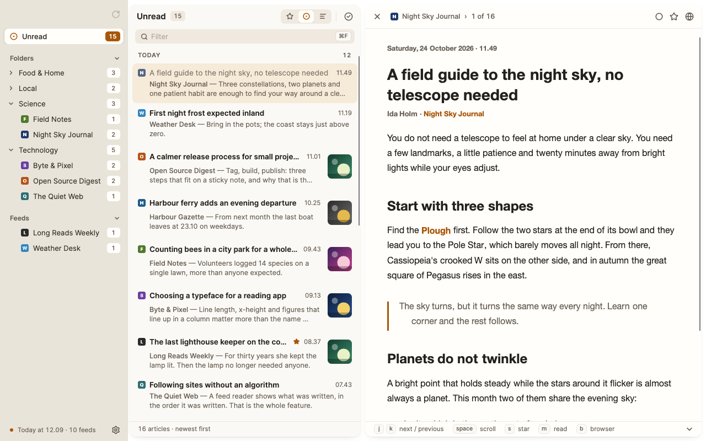

Til venstre er dine feeds, samlet i mapper. I midten er artiklerne, grupperet efter dag. Til højre er den artikel,
du læser. En lille server gemmer dine feeds og artikler i én SQLite-fil, opdaterer dem og serverer appen til din
browser. Der er én nøgle og ingen konti: den, der har nøglen, læser biblioteket fra så mange enheder, de vil, og det,
der er læst på én, er læst på dem alle.

Bygget i .NET 10, ASP.NET Core og [Avalonia](https://avaloniaui.net) 12, som kører i browseren som WebAssembly. Kun gratis komponenter med MIT- eller lignende licenser;
se [Docs/dependencies.md](Docs/dependencies.md).

## Hvad den kan

- **Tilføj et feed** ud fra en feed-adresse eller blot adressen på et website. RSSmote finder selv sitets feeds og
  viser dem, før noget gemmes.
- **RSS 2.0, Atom, RDF og JSON Feed.** Feeds med ugyldig XML (fx `&nbsp;` midt i en titel) læses alligevel.
- **Mapper**, der kan foldes ind og ud, med antal ulæste på hver mappe og hvert feed.
- **Filtre**: Starred, Unread og All, plus et filterfelt over listen, der søger i titler, resuméer og feednavne.
- **Artikler i browserens egen motor** med appens egen typografi. Scripts, formularer og indlejrede styles fjernes,
  før siden vises.
- **Ét bibliotek, alle enheder.** Læst, stjernemarkeret, mapper og feeds følger dig fra skrivebordet til telefonen med
  det samme; hver enhed beholder sit eget tema og sine egne tekststørrelser.
- **Import og eksport af OPML**, så du kan flytte dine feeds ind og ud.
- **Opdatering** hver halve time på serveren, også når ingen enhed er åben, og med `r`, når du vil. Læste, ikke-stjernemarkerede artikler ryddes
  efter 30 dage.
- **Ti farvetemaer**, fem lyse og fem mørke. Se [Temaer](#temaer).

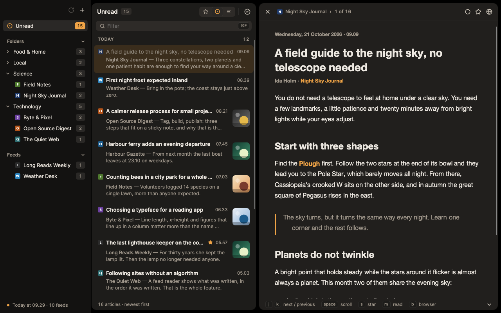

## Tastaturet

Hele appen kan styres uden mus. Tasterne virker ikke, mens du skriver i et felt.

| Tast | Gør |
| --- | --- |
| `j` / `k` | Næste / forrige artikel |
| `space` | Rul ned i artiklen; ved bunden går den videre til næste (`shift+space` ruller op) |
| `m` | Markér som læst / ulæst |
| `s` | Stjernemarkér |
| `b` | Åbn artiklen i browseren |
| `n` / `p` | Næste / forrige feed |
| `r` | Opdatér alle feeds |
| `a` | Markér alt i listen som læst |
| `.` eller `esc` | Luk artiklen |
| `⌘1` `⌘2` `⌘3` | Starred / Unread / All (`Ctrl` i stedet for `⌘` uden for en Mac) |
| `⌘F` | Gå til filterfeltet; `esc` rydder det |
| `⌘,` | Indstillinger: tilføj, ret og fjern feeds, import, eksport, udseende; `esc` går tilbage |
| `⌘N` | Tilføj feed (i Indstillinger) |
| `⌘+` `⌘−` `⌘0` | Større / mindre / standard tekst i artiklen, eller i den rude der er valgt under **Aa**, mens den er åben |

Uden en artikel valgt viser højre side de vigtigste genveje:

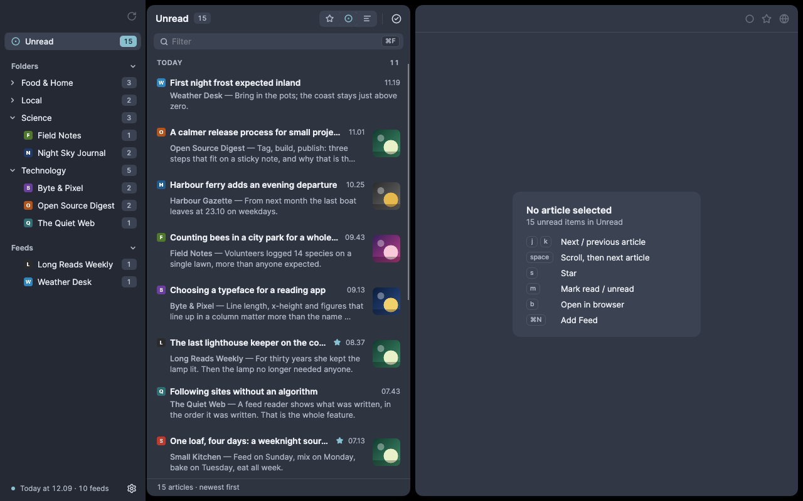

## Skærmbilleder

| | |
| --- | --- |
| 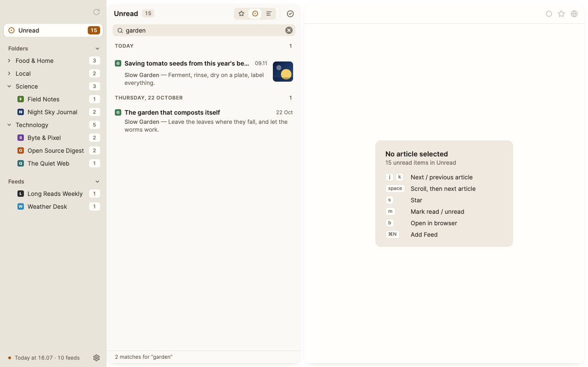 | 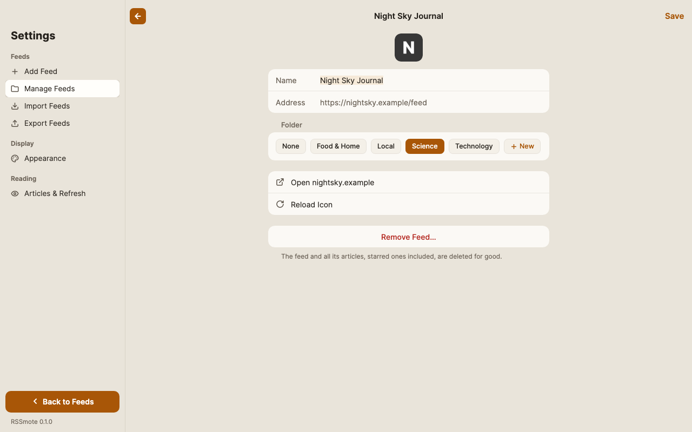 |
| Filterfeltet søger i listen, mens du skriver | Omdøb et feed og flyt det mellem mapper |
| 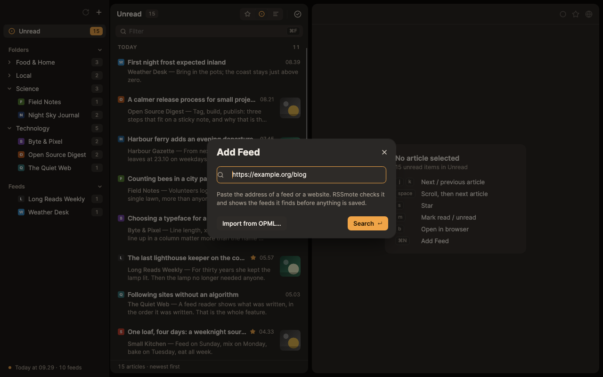 | 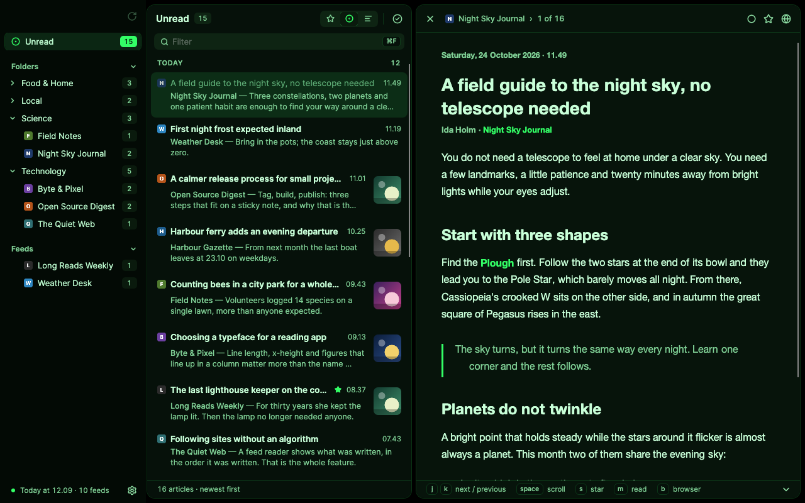 |
| Tilføj et feed ud fra en adresse, i Indstillinger | Phosphor: grønt på et slukket rør |

Alle skærmbilleder er taget af appen selv, uden skærm, over et opdigtet demo-bibliotek: feeds, artikler, favicons og
billeder er lavet til formålet (se `ReadmeCaptureTests.cs` i `tests/RSSmote.Desktop.Tests` og
`tests/RSSmote.Mobile.Tests`). De er tegnet med den indbyggede HTML-renderer, så en artikel ser lidt anderledes ud end i
browseren.

## På mobilen

Åbn samme adresse på telefonen. Under 900 pixels bredde er RSSmote én stak i stedet for tre kolonner, og et
skrivebordsvindue, der gøres så smalt, bliver det samme. Billederne herunder viser et vindue i iPhone-størrelse.

| | | | |
| --- | --- | --- | --- |
| 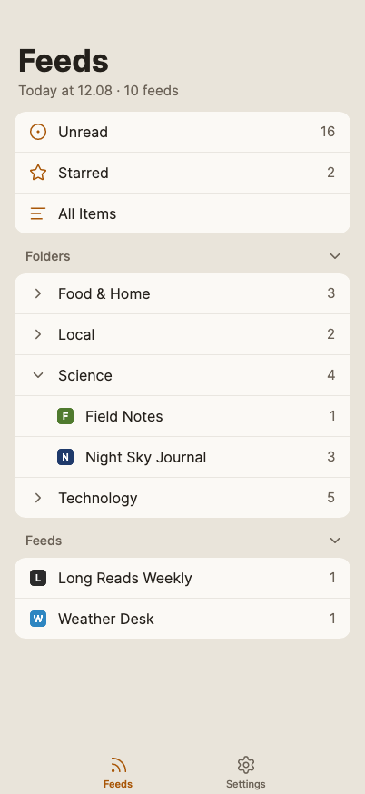 | 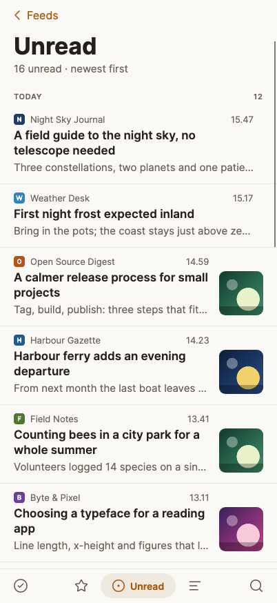 | 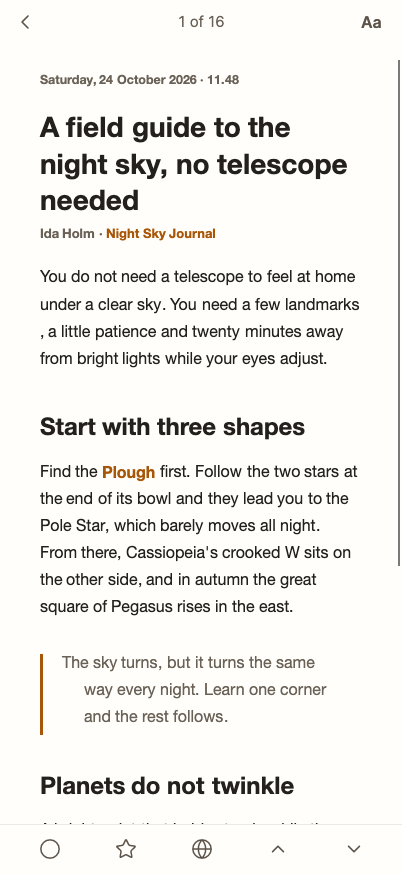 | 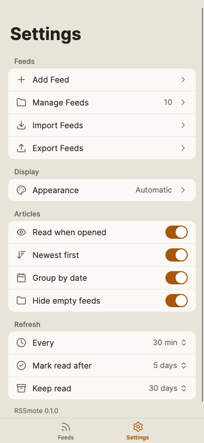 |
| Feeds: strømme, mapper og feeds med antal ulæste | Listen: titler over tre linjer, miniaturer, filteret i bundbjælken | Artiklen: bjælkerne træder til side, mens du ruller ned | Indstillinger: feeds, udseende, læsning og opdatering |

- **Én stak:** Feeds → liste → artikel. Swipe fra kanten eller tryk tilbage for at gå tilbage. Indstillinger er den
  anden fane.
- **Læsning:** forrige og næste er knapper i bundbjælken, ikke swipes. **Aa** på Feeds-siden, listen og artiklen
  sætter sidens tekststørrelse. Indstillinger ▸ Text sætter alle tre og kan følge
  systemets tekststørrelse.
- **Feeds** tilføjes, rettes, fjernes, importeres og eksporteres under Indstillinger, som på skrivebordet. Fjern
  spørger i et ark nedefra.
- **Opdatering:** serveren opdaterer selv; tryk på pilen øverst på Feeds, eller træk ned, for at opdatere nu.
- **Det samme bibliotek** som på skrivebordet: det, du læser på telefonen, er læst alle steder.

Skærmbillederne er tegnet uden skærm i iPhone 17 Pro-størrelse (402 × 874 pt), så de har ingen statuslinje.

## Temaer

Du vælger ét lyst og ét mørkt tema i menuen (**Theme**) eller under Indstillinger ▸ Appearance. Vælger du et tema,
skifter appen til det med det samme. Månen eller solen øverst i sidebaren, eller ved siden af Aa på telefonen, skifter mellem dine to. Du kan sætte den til at følge systemet; så skifter den selv mellem dit lyse og dit
mørke tema, når enheden går fra lyst til mørkt. Hver enhed beholder sit eget valg.

| Lyse | Mørke |
| --- | --- |
| 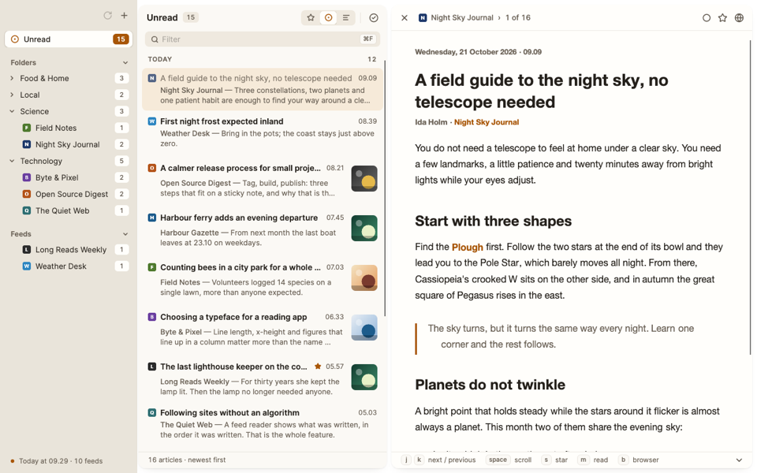 **Sand** — varm sand og rav. Standard. | 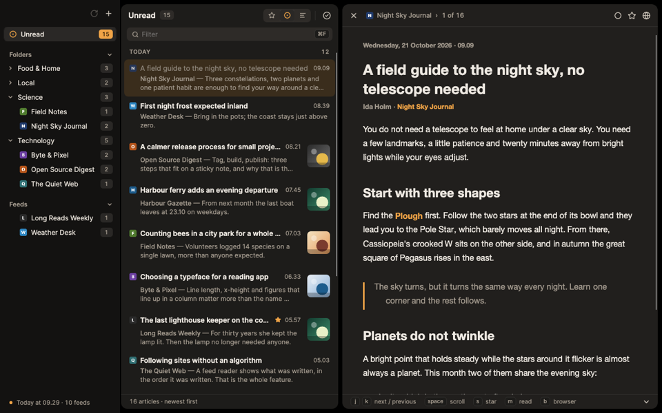 **Ember** — Sand vendt om. Standard. |
| 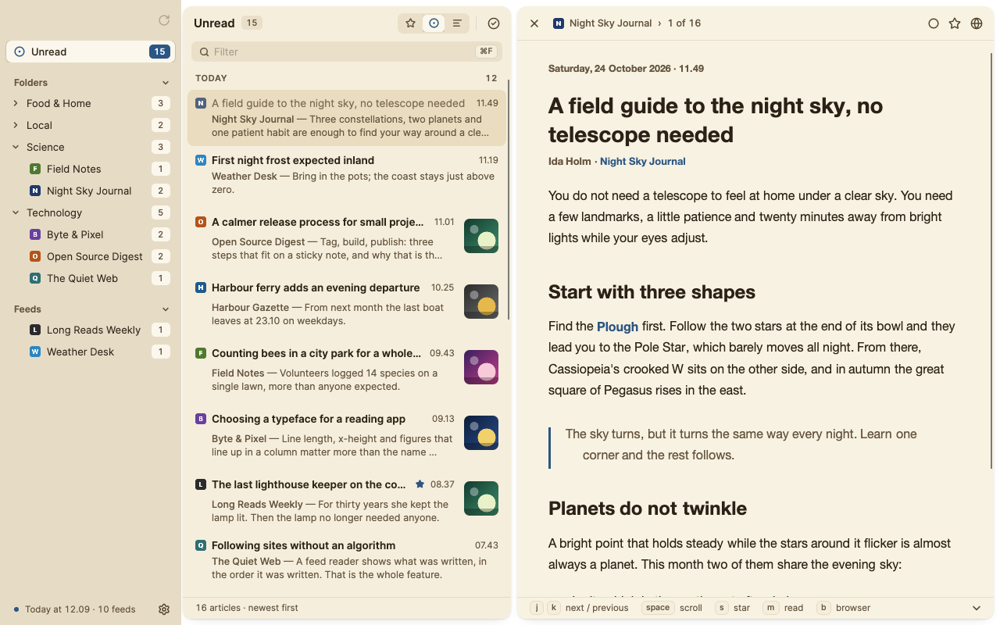 **Newsprint** — sepiapapir og blæk-blå links, til lange læsninger. | 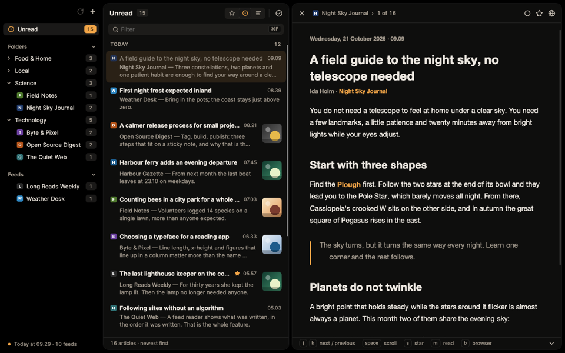 **Black** — helt sort, til OLED-skærme. |
| 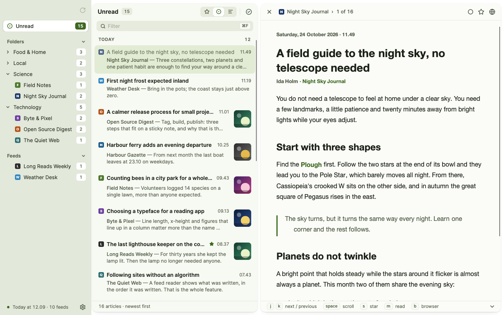 **Fern** — grønlige toner under en skovgrøn accent. | 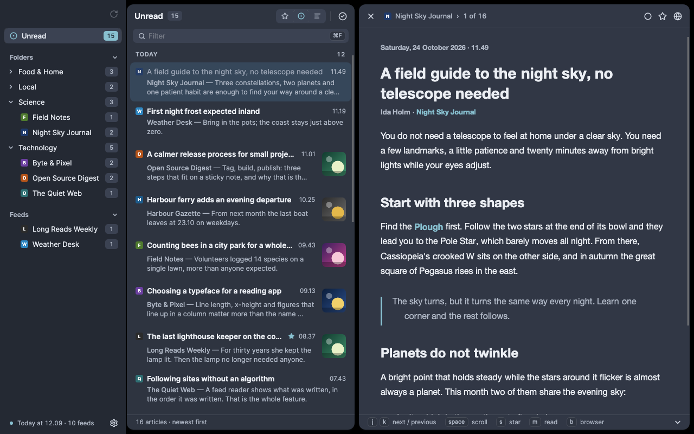 **Fjord** — arktisk blågrå med isblå accent. |
| 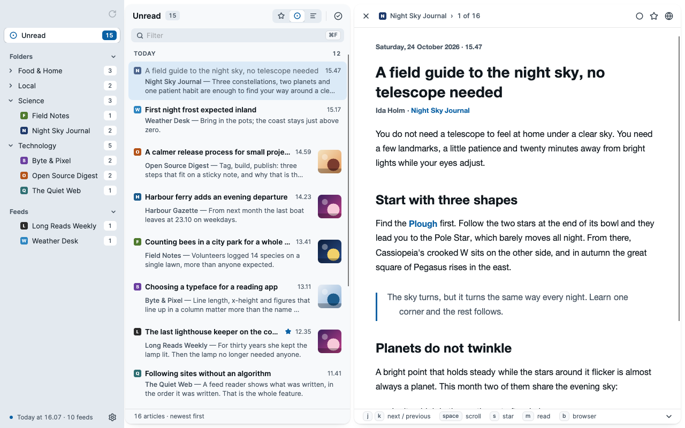 **Harbor** — blå accent og brun advarselsfarve, der også kan skelnes ved farveblindhed. |  **Phosphor** — grønt fosfor; kun advarsler er røde. |
| 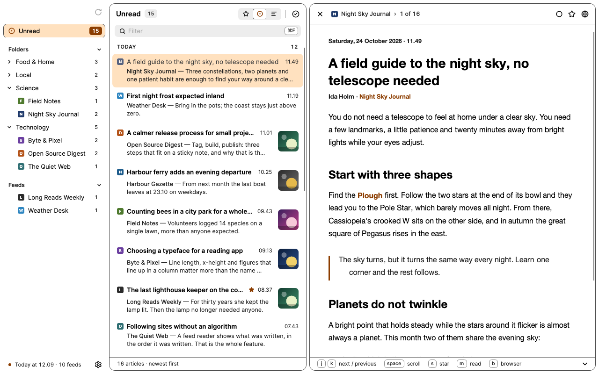 **Contrast** — sort på hvidt med tydelige kanter. | 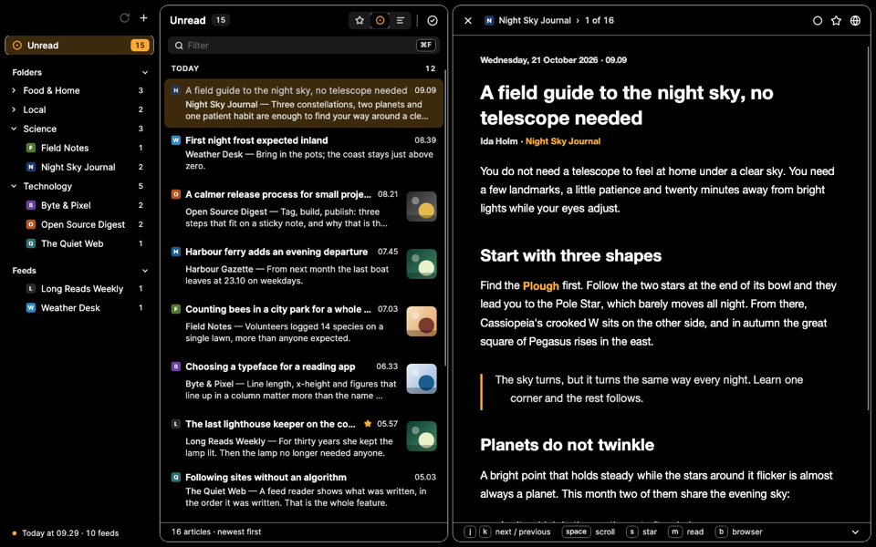 **Contrast Dark** — hvidt på sort med tydelige kanter. |

Hvert tema er kun en palet: størrelser, skrift og afstande er de samme overalt. Alle ti skal klare de samme
kontrastkrav (WCAG 2) for tekst, links og knapper, og en test måler dem direkte i temafilerne. Skriften er
[Inter](https://rsms.me/inter/) i alle browsere, og ikonerne er [Lucide](https://lucide.dev).

## Kør den

Kræver [.NET 10 SDK](https://dotnet.microsoft.com/download). Vælg en nøgle på mindst 12 tegn: det er det eneste, der
logger en enhed ind.

**På denne maskine:**

```bash
RSSMOTE_KEY='en lang nøgle af din egen' build/run-local.sh
```

Åbn <http://localhost:5000> og indtast nøglen. Med `--lan` lytter serveren på alle adresser, så en telefon på samme
netværk kan åbne `http://<denne maskine>:5000`.

**På en server**, med Docker:

```bash
docker build -t rssmote .
```

```bash
docker run -d -p 8080:8080 -e RSSMOTE_KEY='en lang nøgle af din egen' -v rssmote:/data rssmote
```

Eller uden Docker: `build/publish.sh` skriver serveren med appen ved siden af til `artifacts/server`
(`build/publish.sh linux-x64` har sin egen .NET-runtime med). Kør den med `RSSMOTE_KEY` sat.

Sæt den bag en reverse proxy med HTTPS (Caddy, nginx, Traefik), før den kan nås fra internettet, og sæt
`ASPNETCORE_FORWARDEDHEADERS_ENABLED=true`, så serveren ser læserens adresse. Login-forsøg er begrænset til fem i
minuttet pr. adresse. En ny nøgle logger alle enheder ud.

**Tests:**

```bash
dotnet test RSSmote.slnx
```

Testene starter den rigtige app uden skærm (Avalonias headless-platform) og tegner den med Skia, så de også fanger
fejl i layout, temaer og kontrast. Serverens tests kører den i processen og lader to enheder synkronisere gennem den.

### Hvor dine data ligger

På serveren: biblioteket hedder `rssmote.sqlite`, bibliotekets indstillinger `settings.json`, og login-nøglerne ligger
i `keys/`, side om side:

| System | Mappe |
| --- | --- |
| Docker | volumen `/data` |
| macOS | `~/Library/Application Support/com.ahrentlov.rssmote/` |
| Windows | `%LOCALAPPDATA%\RSSmote\` |
| Linux | `$XDG_DATA_HOME/rssmote/` (ellers `~/.local/share/rssmote/`) |

Sæt `RSSMOTE_DATA_DIR` for at bruge en anden mappe. Et bibliotek fra den tidligere skrivebordsapp kan kopieres ind,
som det er. Hver enhed gemmer sit tema og sine tekststørrelser i browserens eget lager.

## Hvad appen henter fra nettet

Serveren henter:

- **Dine feeds** fra de adresser, du har tilføjet.
- **Favicons** gennem Googles favicon-tjeneste (`google.com/s2/favicons`), med sitets domæne som parameter. Google kan
  altså se, hvilke domæner du følger, men ikke hvad du læser.
- **Miniaturer** i listen, på browserens vegne.

Browseren henter **billeder i artiklerne**, når du åbner dem, fra de servere, artiklen peger på. Der er ingen
analytics og ingen sporing. Links åbnes i en ny fane.

## Dokumentation

Projektet er beskrevet i `Docs/`, med en id på hver regel, så kode og dokumenter kan pege på hinanden:

| Fil | Indhold |
| --- | --- |
| [Docs/architecture.md](Docs/architecture.md) | Hvordan appen er bygget op: projekter, shell, lagring, opdatering, artikelvisning |
| [Docs/architecture.html](Docs/architecture.html) | Det samme som diagrammer, på engelsk: projekter, synkronisering, opstart, serveren |
| [Docs/design-language.md](Docs/design-language.md) | Designet: tokens, temaer, typografi, komponenter, ikoner |
| [Docs/pitfalls.md](Docs/pitfalls.md) | Fejl, der ikke siger noget, med rettelse og den måling der beviser den |
| [Docs/todo.md](Docs/todo.md) | Hvad der mangler, og hvordan det tjekkes |
| [Docs/dependencies.md](Docs/dependencies.md) | Alle pakker med version og licens |
| [src/RSSmote.App/Controls/Templates/templates.html](src/RSSmote.App/Controls/Templates/templates.html) | Katalog over appens egne kontroller |

## Ansvarsfraskrivelse

**Skrevet af en maskine.** Hele projektet er genereret af Claude Opus 5.5, en sprogmodel fra Anthropic, med
*reasoning effort* sat til high. Koden er afprøvet af omkring 280 automatiske tests, der kører appen uden skærm, men
den er ikke gennemgået linje for linje af et menneske og ikke revideret af nogen med forstand på sikkerhed. Det betyder
mere, nu hvor den er en server: hold nøglen lang, og hold serveren bag HTTPS. Den er endnu ikke afprøvet af hånd i alle
browsere (se [Docs/todo.md](Docs/todo.md)).

**Ingen garanti.** Appen leveres, som den er, uden nogen form for garanti. Brug den på eget ansvar. Hverken
forfatteren, Anthropic eller nogen anden hæfter for tabte data eller andet, der måtte følge af at bruge den.

**Fjernede feeds er væk.** Fjerner du et feed, slettes det sammen med alle dets artikler, også de stjernemarkerede.
Appen spørger først, men tager ingen kopi. Eksportér dine feeds som OPML, hvis du vil have en sikkerhedskopi af
listen.

**Indholdet er andres.** Artiklerne tilhører dem, der har skrevet dem. RSSmote henter feeds, som de er offentliggjort,
og viser dem til dig; den kopierer ikke noget videre.

Appen er lavet til privat brug og er ikke forbundet med noget firma eller produkt.

## Licens

[MIT](LICENSE). Du må bruge, ændre og videregive koden, også kommercielt, så længe copyright-linjen og licensteksten
følger med. Pakkerne, skriften og ikonerne har deres egne licenser (MIT, Apache 2.0, OFL og ISC); se
[Docs/dependencies.md](Docs/dependencies.md).
