# RSSmote

**English** · [Dansk](README.da.md)

An RSS reader for macOS, Windows and Linux. Three columns, keyboard first, and everything stored locally.

**This app was written by a machine intelligence.** All the code, the comments, the design, the ten colour themes, the
app icon, the tests, the documentation and this README were made by Claude Opus 5.5 (Anthropic, with *reasoning
effort* set to high) from a human's description. No human has reviewed the code line by line. Read the
[Disclaimer](#disclaimer) before you trust it with anything you care about.

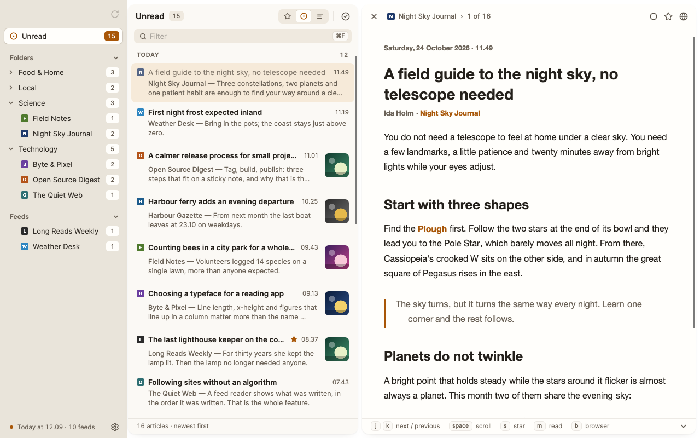

On the left are your feeds, gathered in folders. In the middle are the articles, grouped by day. On the right is the
article you are reading. There is no account, no sync and no cloud: your feeds and articles live in one SQLite file on
your own machine.

Built with .NET 10 and [Avalonia](https://avaloniaui.net) 12. Only free components with MIT or similar licences; see
[Docs/dependencies.md](Docs/dependencies.md).

## What it does

- **Add a feed** from a feed address or just the address of a website. RSSmote finds the site's feeds itself and
  shows them before anything is saved.
- **RSS 2.0, Atom, RDF and JSON Feed.** Feeds with invalid XML (such as `&nbsp;` in the middle of a title) are read
  anyway.
- **Folders** that fold in and out, with unread counts on every folder and feed.
- **Filters**: Starred, Unread and All, plus a filter box above the list that searches titles, summaries and feed
  names.
- **Articles in the OS's own web engine** (WebKit on macOS, WebView2 on Windows, WebKitGTK on Linux) with the app's
  own typography. Scripts, forms and inline styles are removed before the page is shown. Where there is no web engine,
  a built-in HTML renderer shows the same page.
- **OPML import and export**, so you can move your feeds in and out.
- **Refresh** every half hour in the background, and with `r` whenever you like. Read, unstarred articles are cleared
  after 30 days.
- **Ten colour themes**, five light and five dark. See [Themes](#themes).

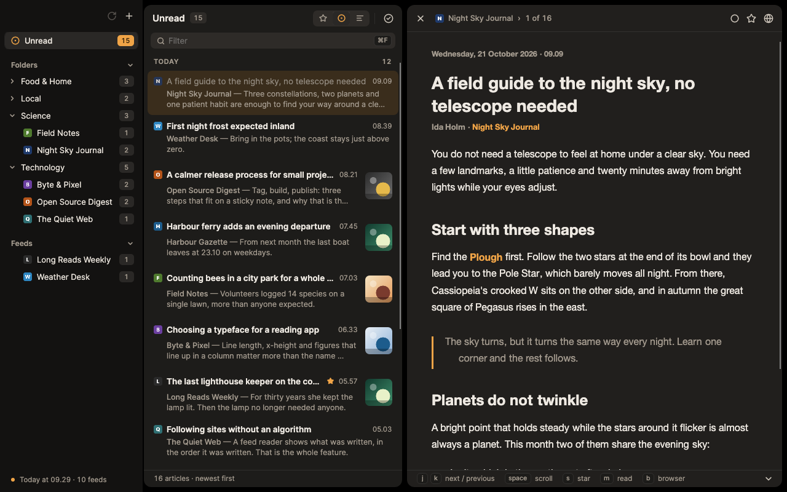

## The keyboard

The whole app can be driven without a mouse. The keys do nothing while you type in a field.

| Key | Does |
| --- | --- |
| `j` / `k` | Next / previous article |
| `space` | Scroll down the article; at the bottom it moves on to the next (`shift+space` scrolls up) |
| `m` | Mark as read / unread |
| `s` | Star |
| `b` | Open the article in the browser |
| `n` / `p` | Next / previous feed |
| `r` | Refresh all feeds |
| `a` | Mark everything in the list as read |
| `.` or `esc` | Close the article |
| `⌘1` `⌘2` `⌘3` | Starred / Unread / All (`Ctrl` on Windows and Linux) |
| `⌘F` | Go to the filter box; `esc` clears it |
| `⌘,` | Settings: add, edit and remove feeds, import, export, appearance; `esc` goes back |
| `⌘N` | Add a feed (in Settings) |
| `⌘+` `⌘−` `⌘0` | Larger / smaller / normal text in the article |

With no article selected, the right side shows the most important shortcuts:

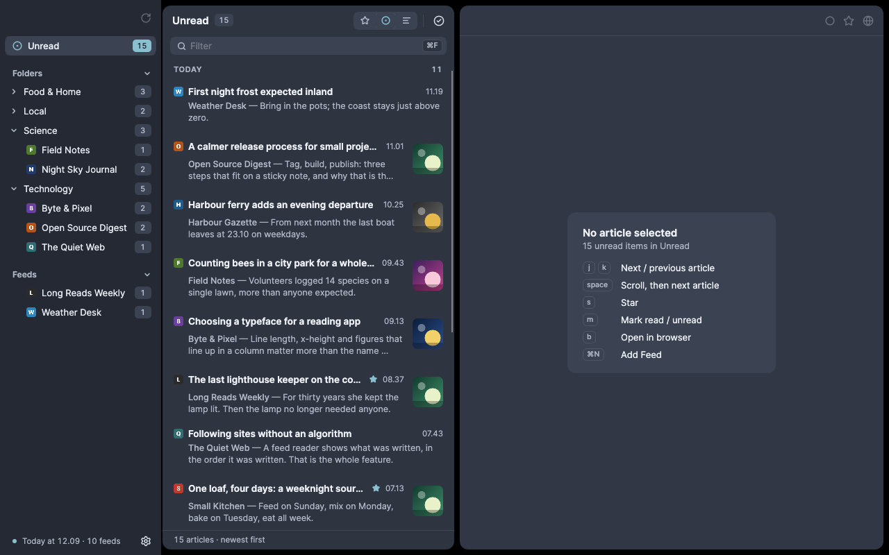

## Screenshots

| | |
| --- | --- |
| 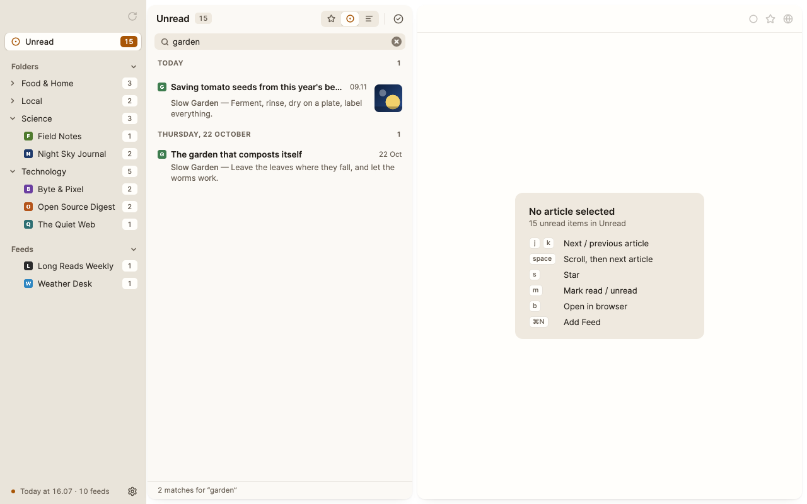 | 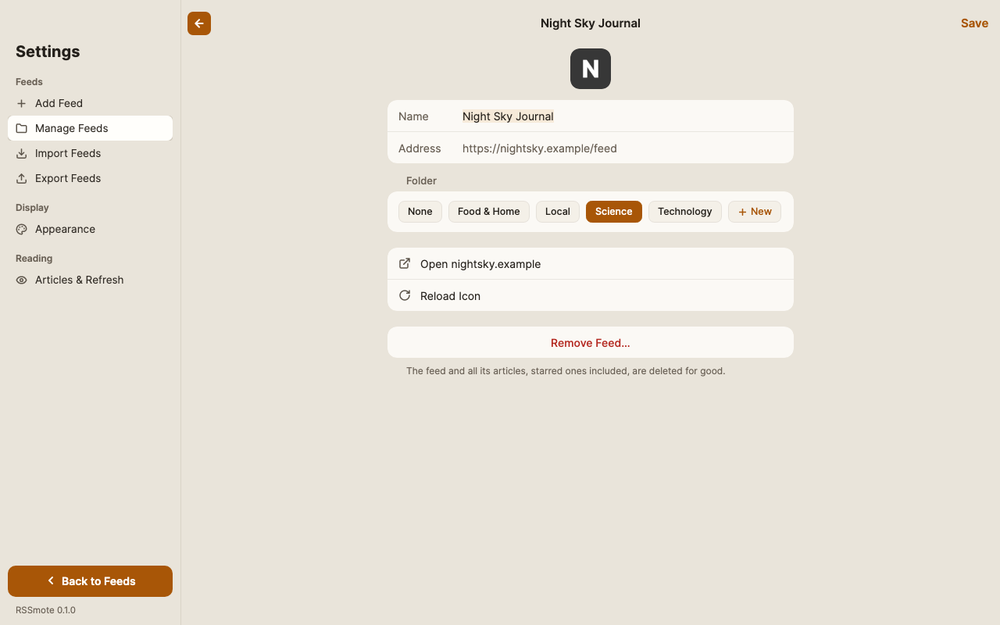 |
| The filter box searches the list as you type | Rename a feed and move it between folders |
| 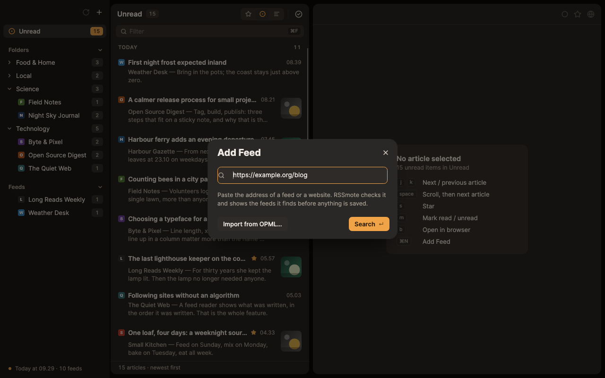 | 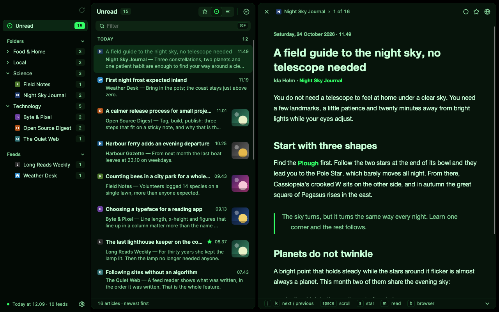 |
| Add a feed from an address, in Settings | Phosphor: green on an unlit tube |

Every screenshot is taken by the app itself, without a screen, over a made-up demo library: the feeds, articles,
favicons and images are invented for the purpose (see `tests/RSSmote.Desktop.Tests/ReadmeCaptureTests.cs`).

## Themes

You choose one light and one dark theme under **View ▸ Theme**. Picking a theme switches the app to it at once. Under
**Appearance** you can set it to follow the system; it then switches by itself between your light and your dark theme
when macOS, Windows or Linux goes from light to dark.

| Light | Dark |
| --- | --- |
| 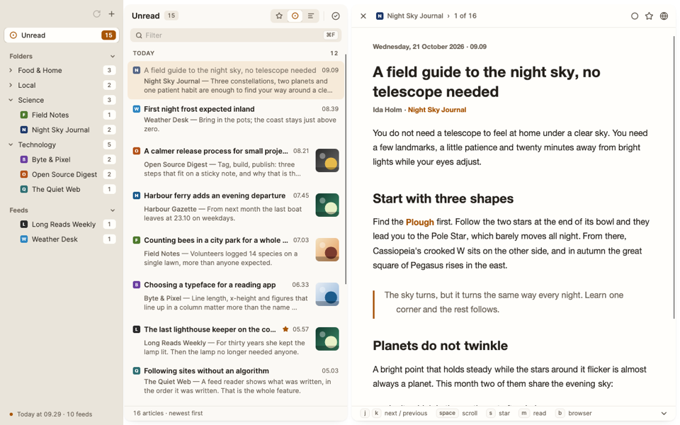 **Sand** — warm sand and amber. The default. | 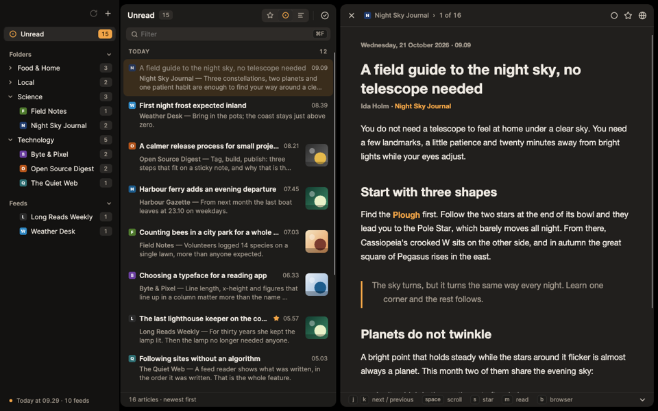 **Ember** — Sand turned over. The default. |
| 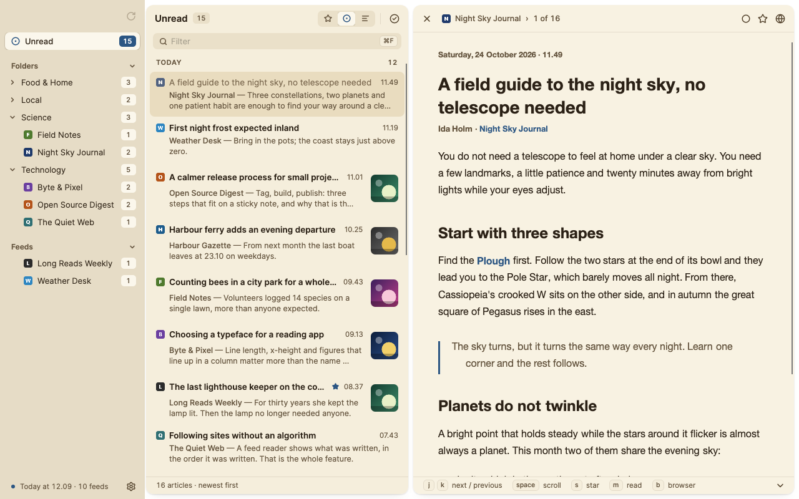 **Newsprint** — sepia paper and ink-blue links, for long reads. | 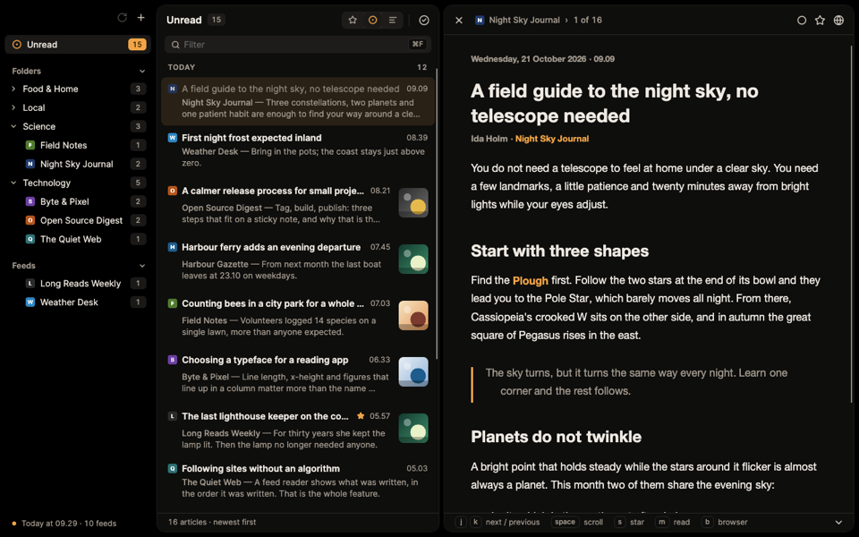 **Black** — pure black, for OLED screens. |
| 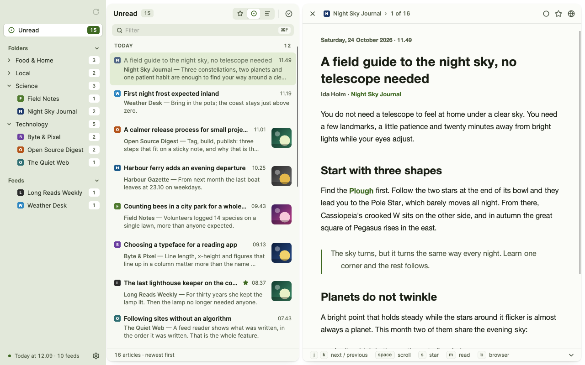 **Fern** — green-leaning tones under a forest-green accent. | 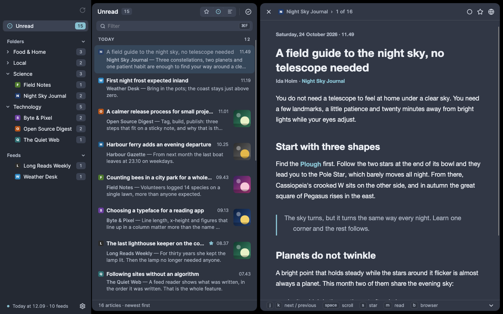 **Fjord** — arctic blue-grey with an ice-blue accent. |
| 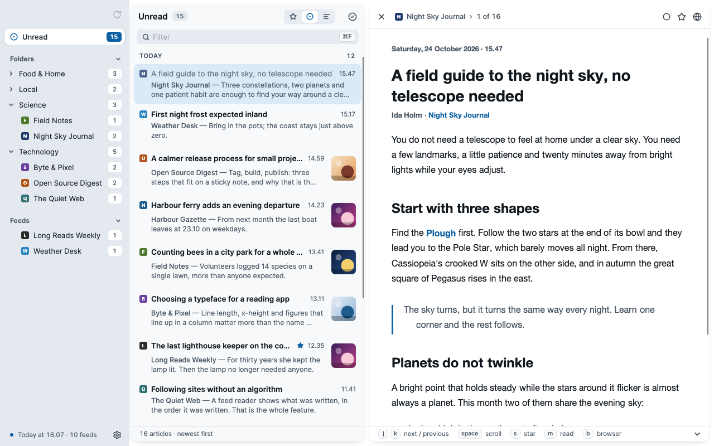 **Harbor** — a blue accent and a brown warning colour that stay apart under colour blindness. |  **Phosphor** — green phosphor; only warnings are red. |
| 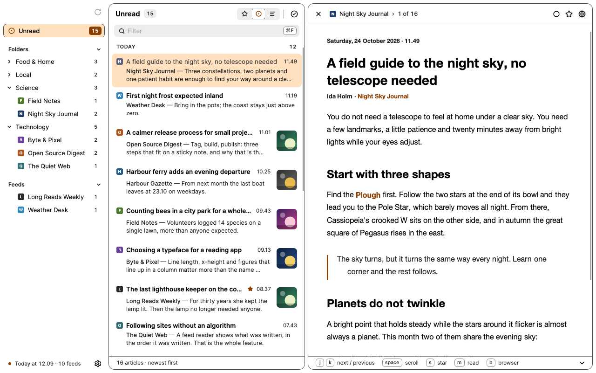 **Contrast** — black on white with clear edges. | 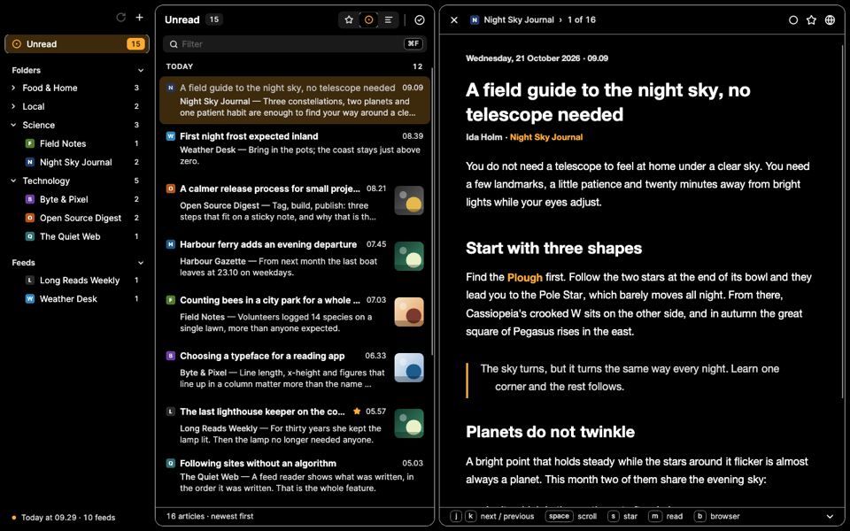 **Contrast Dark** — white on black with clear edges. |

Each theme is only a palette: sizes, type and spacing are the same everywhere. All ten must meet the same contrast
requirements (WCAG 2) for text, links and buttons, and a test measures them directly in the theme files. The typeface
is [Inter](https://rsms.me/inter/) on all three operating systems, and the icons are [Lucide](https://lucide.dev).

## Build and run

Requires the [.NET 10 SDK](https://dotnet.microsoft.com/download).

```bash
dotnet build RSSmote.slnx
```

```bash
dotnet run --project src/RSSmote.Desktop
```

Run the tests:

```bash
dotnet test RSSmote.slnx
```

The tests start the real app without a screen (Avalonia's headless platform) and draw it with Skia, so they also catch
mistakes in layout, themes and contrast. There are no finished installers yet; build it yourself as above.

**Linux:** articles are shown in WebKitGTK 4.1 with libsoup 3. Without them the app uses the built-in HTML renderer
instead, which cannot show video.

### Where your data lives

The library is called `rssmote.sqlite` and the preferences `settings.json`. They sit side by side:

| System | Folder |
| --- | --- |
| macOS | `~/Library/Application Support/com.ahrentlov.rssmote/` |
| Windows | `%LOCALAPPDATA%\RSSmote\` |
| Linux | `$XDG_DATA_HOME/rssmote/` (otherwise `~/.local/share/rssmote/`) |

Set the environment variable `RSSMOTE_DATA_DIR` to use another folder, for example for a test library.

## What the app fetches from the network

- **Your feeds**, from the addresses you have added.
- **Favicons**, through Google's favicon service (`google.com/s2/favicons`), with the site's domain as a parameter.
  Google can therefore see which domains you follow, but not what you read.
- **Images in articles**, when you open them, from the servers the article points to.

There are no analytics, no tracking and no account. Links open in your browser, not in the app.

## Documentation

The project is described in `Docs/`, with an id on every rule, so code and documents can point to each other:

| File | Contents |
| --- | --- |
| [Docs/architecture.md](Docs/architecture.md) | How the app is put together: projects, shell, storage, refresh, article rendering |
| [Docs/design-language.md](Docs/design-language.md) | The design: tokens, themes, typography, components, icons |
| [Docs/pitfalls.md](Docs/pitfalls.md) | Failures that say nothing, with the fix and the measurement that proves it |
| [Docs/todo.md](Docs/todo.md) | What is missing, and how to check it |
| [Docs/dependencies.md](Docs/dependencies.md) | Every package with its version and licence |
| [src/RSSmote.App/Controls/Templates/templates.html](src/RSSmote.App/Controls/Templates/templates.html) | A catalogue of the app's own controls |

## Disclaimer

**Written by a machine.** The whole project was generated by Claude Opus 5.5, a language model from Anthropic, with
*reasoning effort* set to high. The code is exercised by about 240 automated tests that run the app without a screen,
but it has not been reviewed line by line by a human, nor audited by anyone with security expertise. The native article
view has not yet been tried by hand on Windows and Linux (see [Docs/todo.md](Docs/todo.md)).

**No warranty.** The app is provided as is, without warranty of any kind. Use it at your own risk. Neither the author,
Anthropic nor anyone else is liable for lost data or anything else that may follow from using it.

**Removed feeds are gone.** When you remove a feed, it is deleted together with all its articles, starred ones too.
The app asks first, but keeps no copy. Export your feeds as OPML if you want a backup of the list.

**The content belongs to others.** Articles belong to those who wrote them. RSSmote fetches feeds as they are
published and shows them to you; it passes nothing on.

**Not signed.** There are no signed or notarised packages. If you build it yourself, macOS and Windows may warn the
first time the app is opened.

The app is made for private use and is not affiliated with any company or product.

## Licence

[MIT](LICENSE). You may use, change and pass on the code, commercially too, as long as the copyright line and the
licence text go with it. The packages, the typeface and the icons have their own licences (MIT, Apache 2.0, OFL and
ISC); see [Docs/dependencies.md](Docs/dependencies.md).
